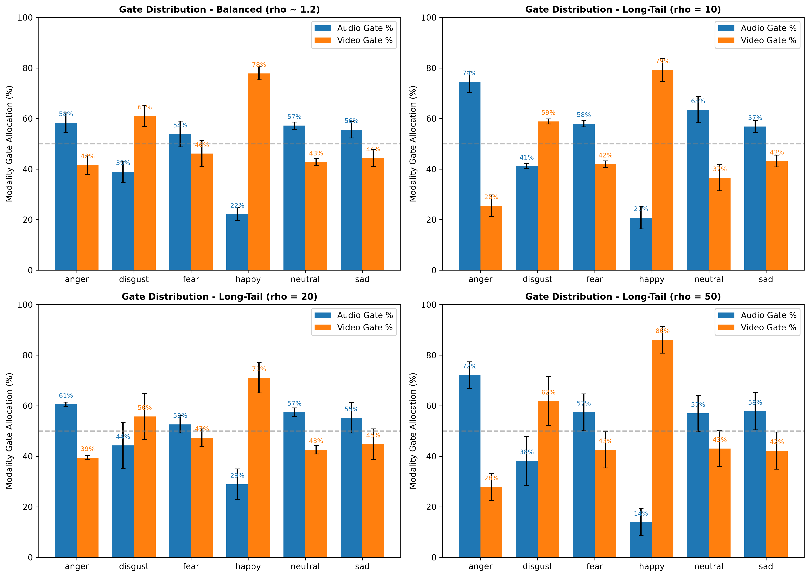

# CREMA-D Multimodal Emotion Recognition Report
## Step 10: Benchmark Results, Ablations, Cluster Bootstrap Tests, and Gate Analysis

> **Evaluation Integrity Guarantee**: All models evaluated on 6-class emotion recognition (`anger`, `disgust`, `fear`, `happy`, `neutral`, `sad`) using frozen pretrained backbones (WavLM audio + DINOv2 video). Disjoint actor splits (64 train / 14 val / 13 test) strictly preserved. Feature scalers fit strictly on balanced train. Checkpoints selected strictly by validation Macro-F1. Test set evaluated strictly once per seed.

---
## 1. Executive Summary & Honest Method Rankings

Across all four imbalance settings, performance differences between top rebalancing methods are small and frequently within one seed standard deviation or statistically indistinguishable ($p > 0.05$). Under cluster bootstrap and seed-level variation, most pairwise comparisons between top strategies represent statistical ties.

### Honest Ranking of RCS-Optimal (Fusion V2) Among the 6 Standard Rebalancing Methods

| Setting | Imbalance Ratio ($\rho$) | Best Method | Best Test Macro-F1 | RCS-Optimal Test Macro-F1 | RCS-Optimal Rank | Outcome Relative to Top Baseline |
| :--- | :---: | :--- | :---: | :---: | :---: | :--- |
| balanced | 1.2 | `balanced_softmax` | 0.8109 $\pm$ 0.0009 | 0.8062 $\pm$ 0.0077 | Rank 5 of 6 | Statistical Tie with Best (Rank 5 of 6) |
| lt_rho10 | 10 | `RCS-Optimal` | 0.7743 $\pm$ 0.0070 | 0.7743 $\pm$ 0.0070 | Rank 1 of 6 | Statistical Tie (Rank 1 of 6) |
| lt_rho20 | 20 | `balanced_softmax` | 0.7572 $\pm$ 0.0146 | 0.7443 $\pm$ 0.0048 | Rank 2 of 6 | Statistical Tie with Best (Rank 2 of 6) |
| lt_rho50 | 50 | `balanced_softmax` | 0.6711 $\pm$ 0.0189 | 0.6667 $\pm$ 0.0180 | Rank 2 of 6 | Statistical Tie with Best (Rank 2 of 6) |

#### Method Ranking Observations (Regenerated from `master_table.csv`):
- **Balanced (rho ~ 1.2)**: RCS-Optimal achieves Macro-F1 of 0.8062 $\pm$ 0.0077 (Rank 5 of 6), compared to best method `balanced_softmax` at 0.8109 $\pm$ 0.0009. The difference is 0.0047, which falls within 1 seed standard deviation (0.0077) and represents a statistical tie.
- **Long-Tail (rho = 10)**: RCS-Optimal achieves Macro-F1 of 0.7743 $\pm$ 0.0070 (Rank 1 of 6), compared to best method `RCS-Optimal` at 0.7743 $\pm$ 0.0070. The difference is 0.0000, which falls within 1 seed standard deviation (0.0070) and represents a statistical tie.
- **Long-Tail (rho = 20)**: RCS-Optimal achieves Macro-F1 of 0.7443 $\pm$ 0.0048 (Rank 2 of 6), compared to best method `balanced_softmax` at 0.7572 $\pm$ 0.0146. The difference is 0.0129, which falls within 1 seed standard deviation (0.0146) and represents a statistical tie.
- **Long-Tail (rho = 50)**: RCS-Optimal achieves Macro-F1 of 0.6667 $\pm$ 0.0180 (Rank 2 of 6), compared to best method `balanced_softmax` at 0.6711 $\pm$ 0.0189. The difference is 0.0045, which falls within 1 seed standard deviation (0.0189) and represents a statistical tie.

---
## 2. Complete Master Benchmark Table

Results report Mean $\pm$ Standard Deviation across 3 master random seeds (42, 43, 44) evaluated strictly once on the held-out test split (1,065 clips).

| Setting | Representation | Method | Test Macro-F1 | Balanced Acc | G-Mean | Test Accuracy |
| :--- | :--- | :--- | :---: | :---: | :---: | :---: |
| balanced | `fusion_v2` | `balanced_softmax` | **0.8109 $\pm$ 0.0009** | 0.8100 $\pm$ 0.0002 | 0.8057 $\pm$ 0.0010 | 0.8097 $\pm$ 0.0009 |
| balanced | `fusion_v2_nogate` | `random_oversample` | 0.8107 $\pm$ 0.0043 | 0.8095 $\pm$ 0.0042 | 0.8052 $\pm$ 0.0047 | 0.8091 $\pm$ 0.0046 |
| balanced | `fusion_v2` | `class_weighted_CE` | 0.8106 $\pm$ 0.0019 | 0.8096 $\pm$ 0.0015 | 0.8054 $\pm$ 0.0021 | 0.8094 $\pm$ 0.0020 |
| balanced | `fusion_v2` | `no_rebalance` | 0.8083 $\pm$ 0.0053 | 0.8075 $\pm$ 0.0044 | 0.8033 $\pm$ 0.0050 | 0.8072 $\pm$ 0.0051 |
| balanced | `fusion_v2` | `latent_SMOTE` | 0.8083 $\pm$ 0.0065 | 0.8070 $\pm$ 0.0056 | 0.8030 $\pm$ 0.0067 | 0.8069 $\pm$ 0.0062 |
| balanced | `fusion_v2` | `RCS_balanced_softmax` | 0.8071 $\pm$ 0.0091 | 0.8064 $\pm$ 0.0085 | 0.8023 $\pm$ 0.0096 | 0.8059 $\pm$ 0.0089 |
| balanced | `fusion_v2_nogate` | `latent_SMOTE` | 0.8068 $\pm$ 0.0107 | 0.8053 $\pm$ 0.0111 | 0.8006 $\pm$ 0.0117 | 0.8050 $\pm$ 0.0112 |
| balanced | `fusion_v2_nogate` | `RCS-Optimal` | 0.8063 $\pm$ 0.0080 | 0.8050 $\pm$ 0.0086 | 0.8000 $\pm$ 0.0085 | 0.8047 $\pm$ 0.0088 |
| balanced | `fusion_v2` | `RCS-Optimal` | 0.8062 $\pm$ 0.0077 | 0.8051 $\pm$ 0.0071 | 0.8009 $\pm$ 0.0081 | 0.8047 $\pm$ 0.0076 |
| balanced | `fusion_v2_nogate` | `RCS_balanced_softmax` | 0.8059 $\pm$ 0.0065 | 0.8046 $\pm$ 0.0067 | 0.7998 $\pm$ 0.0070 | 0.8041 $\pm$ 0.0071 |
| balanced | `fusion_v2` | `random_oversample` | 0.8052 $\pm$ 0.0075 | 0.8040 $\pm$ 0.0068 | 0.7998 $\pm$ 0.0080 | 0.8038 $\pm$ 0.0074 |
| balanced | `concat_MLP_raw_features` | `random_oversample` | 0.8043 $\pm$ 0.0029 | 0.8026 $\pm$ 0.0030 | 0.7987 $\pm$ 0.0036 | 0.8028 $\pm$ 0.0028 |
| balanced | `fusion_v2_nogate` | `balanced_softmax` | 0.8041 $\pm$ 0.0032 | 0.8021 $\pm$ 0.0045 | 0.7978 $\pm$ 0.0040 | 0.8016 $\pm$ 0.0046 |
| balanced | `fusion_v2_nogate` | `no_rebalance` | 0.8035 $\pm$ 0.0033 | 0.8014 $\pm$ 0.0048 | 0.7971 $\pm$ 0.0042 | 0.8009 $\pm$ 0.0048 |
| balanced | `fusion_v2_nogate` | `class_weighted_CE` | 0.8035 $\pm$ 0.0033 | 0.8015 $\pm$ 0.0047 | 0.7971 $\pm$ 0.0042 | 0.8009 $\pm$ 0.0048 |
| balanced | `concat_MLP_raw_features` | `no_rebalance` | 0.8015 $\pm$ 0.0074 | 0.8003 $\pm$ 0.0074 | 0.7961 $\pm$ 0.0082 | 0.8003 $\pm$ 0.0070 |
| balanced | `concat_MLP_raw_features` | `RCS-Optimal` | 0.8015 $\pm$ 0.0052 | 0.8010 $\pm$ 0.0049 | 0.7971 $\pm$ 0.0052 | 0.8003 $\pm$ 0.0045 |
| balanced | `concat_MLP_raw_features` | `balanced_softmax` | 0.8008 $\pm$ 0.0012 | 0.8001 $\pm$ 0.0020 | 0.7956 $\pm$ 0.0018 | 0.8000 $\pm$ 0.0015 |
| balanced | `concat_MLP_raw_features` | `class_weighted_CE` | 0.7991 $\pm$ 0.0041 | 0.7987 $\pm$ 0.0037 | 0.7937 $\pm$ 0.0044 | 0.7981 $\pm$ 0.0038 |
| balanced | `concat_MLP_raw_features` | `latent_SMOTE` | 0.7956 $\pm$ 0.0042 | 0.7947 $\pm$ 0.0047 | 0.7903 $\pm$ 0.0053 | 0.7947 $\pm$ 0.0044 |
| balanced | `concat_MLP_raw_features` | `RCS_balanced_softmax` | 0.7862 $\pm$ 0.0056 | 0.7857 $\pm$ 0.0071 | 0.7811 $\pm$ 0.0070 | 0.7856 $\pm$ 0.0064 |
| lt_rho10 | `fusion_v2` | `RCS-Optimal` | **0.7743 $\pm$ 0.0070** | 0.7752 $\pm$ 0.0062 | 0.7695 $\pm$ 0.0075 | 0.7737 $\pm$ 0.0067 |
| lt_rho10 | `fusion_v2` | `balanced_softmax` | 0.7725 $\pm$ 0.0093 | 0.7724 $\pm$ 0.0089 | 0.7661 $\pm$ 0.0103 | 0.7715 $\pm$ 0.0090 |
| lt_rho10 | `fusion_v2_nogate` | `balanced_softmax` | 0.7704 $\pm$ 0.0025 | 0.7723 $\pm$ 0.0028 | 0.7634 $\pm$ 0.0030 | 0.7712 $\pm$ 0.0023 |
| lt_rho10 | `concat_MLP_raw_features` | `balanced_softmax` | 0.7687 $\pm$ 0.0083 | 0.7713 $\pm$ 0.0082 | 0.7625 $\pm$ 0.0086 | 0.7709 $\pm$ 0.0080 |
| lt_rho10 | `concat_MLP_raw_features` | `class_weighted_CE` | 0.7678 $\pm$ 0.0069 | 0.7701 $\pm$ 0.0077 | 0.7601 $\pm$ 0.0063 | 0.7706 $\pm$ 0.0078 |
| lt_rho10 | `fusion_v2` | `class_weighted_CE` | 0.7646 $\pm$ 0.0076 | 0.7654 $\pm$ 0.0061 | 0.7564 $\pm$ 0.0088 | 0.7646 $\pm$ 0.0064 |
| lt_rho10 | `fusion_v2` | `random_oversample` | 0.7609 $\pm$ 0.0076 | 0.7622 $\pm$ 0.0064 | 0.7530 $\pm$ 0.0093 | 0.7609 $\pm$ 0.0064 |
| lt_rho10 | `fusion_v2_nogate` | `RCS-Optimal` | 0.7592 $\pm$ 0.0075 | 0.7594 $\pm$ 0.0061 | 0.7499 $\pm$ 0.0078 | 0.7587 $\pm$ 0.0066 |
| lt_rho10 | `fusion_v2` | `latent_SMOTE` | 0.7570 $\pm$ 0.0143 | 0.7591 $\pm$ 0.0121 | 0.7476 $\pm$ 0.0168 | 0.7581 $\pm$ 0.0124 |
| lt_rho10 | `fusion_v2_nogate` | `random_oversample` | 0.7546 $\pm$ 0.0049 | 0.7589 $\pm$ 0.0035 | 0.7432 $\pm$ 0.0066 | 0.7581 $\pm$ 0.0039 |
| lt_rho10 | `fusion_v2_nogate` | `class_weighted_CE` | 0.7520 $\pm$ 0.0029 | 0.7555 $\pm$ 0.0035 | 0.7419 $\pm$ 0.0023 | 0.7546 $\pm$ 0.0032 |
| lt_rho10 | `fusion_v2` | `RCS_balanced_softmax` | 0.7516 $\pm$ 0.0193 | 0.7520 $\pm$ 0.0179 | 0.7403 $\pm$ 0.0224 | 0.7499 $\pm$ 0.0185 |
| lt_rho10 | `fusion_v2_nogate` | `RCS_balanced_softmax` | 0.7495 $\pm$ 0.0088 | 0.7465 $\pm$ 0.0111 | 0.7332 $\pm$ 0.0112 | 0.7449 $\pm$ 0.0102 |
| lt_rho10 | `fusion_v2_nogate` | `latent_SMOTE` | 0.7472 $\pm$ 0.0043 | 0.7522 $\pm$ 0.0043 | 0.7341 $\pm$ 0.0040 | 0.7512 $\pm$ 0.0043 |
| lt_rho10 | `concat_MLP_raw_features` | `no_rebalance` | 0.7448 $\pm$ 0.0087 | 0.7526 $\pm$ 0.0072 | 0.7305 $\pm$ 0.0109 | 0.7534 $\pm$ 0.0070 |
| lt_rho10 | `concat_MLP_raw_features` | `latent_SMOTE` | 0.7422 $\pm$ 0.0126 | 0.7454 $\pm$ 0.0134 | 0.7307 $\pm$ 0.0123 | 0.7459 $\pm$ 0.0138 |
| lt_rho10 | `concat_MLP_raw_features` | `RCS_balanced_softmax` | 0.7368 $\pm$ 0.0029 | 0.7359 $\pm$ 0.0028 | 0.7274 $\pm$ 0.0033 | 0.7365 $\pm$ 0.0029 |
| lt_rho10 | `concat_MLP_raw_features` | `random_oversample` | 0.7366 $\pm$ 0.0155 | 0.7422 $\pm$ 0.0161 | 0.7220 $\pm$ 0.0160 | 0.7421 $\pm$ 0.0162 |
| lt_rho10 | `fusion_v2` | `no_rebalance` | 0.7355 $\pm$ 0.0097 | 0.7394 $\pm$ 0.0083 | 0.7193 $\pm$ 0.0125 | 0.7390 $\pm$ 0.0087 |
| lt_rho10 | `fusion_v2_nogate` | `no_rebalance` | 0.7311 $\pm$ 0.0024 | 0.7391 $\pm$ 0.0018 | 0.7116 $\pm$ 0.0057 | 0.7387 $\pm$ 0.0019 |
| lt_rho10 | `concat_MLP_raw_features` | `RCS-Optimal` | 0.7138 $\pm$ 0.0068 | 0.7157 $\pm$ 0.0059 | 0.6973 $\pm$ 0.0078 | 0.7177 $\pm$ 0.0058 |
| lt_rho20 | `fusion_v2` | `balanced_softmax` | **0.7572 $\pm$ 0.0146** | 0.7596 $\pm$ 0.0145 | 0.7469 $\pm$ 0.0165 | 0.7590 $\pm$ 0.0139 |
| lt_rho20 | `fusion_v2_nogate` | `balanced_softmax` | 0.7502 $\pm$ 0.0038 | 0.7510 $\pm$ 0.0051 | 0.7419 $\pm$ 0.0050 | 0.7505 $\pm$ 0.0044 |
| lt_rho20 | `concat_MLP_raw_features` | `balanced_softmax` | 0.7451 $\pm$ 0.0026 | 0.7499 $\pm$ 0.0018 | 0.7348 $\pm$ 0.0044 | 0.7499 $\pm$ 0.0016 |
| lt_rho20 | `fusion_v2` | `RCS-Optimal` | 0.7443 $\pm$ 0.0048 | 0.7462 $\pm$ 0.0054 | 0.7320 $\pm$ 0.0031 | 0.7455 $\pm$ 0.0047 |
| lt_rho20 | `fusion_v2_nogate` | `RCS-Optimal` | 0.7358 $\pm$ 0.0089 | 0.7343 $\pm$ 0.0074 | 0.7268 $\pm$ 0.0096 | 0.7330 $\pm$ 0.0077 |
| lt_rho20 | `fusion_v2` | `class_weighted_CE` | 0.7332 $\pm$ 0.0143 | 0.7421 $\pm$ 0.0103 | 0.7122 $\pm$ 0.0196 | 0.7412 $\pm$ 0.0102 |
| lt_rho20 | `fusion_v2` | `random_oversample` | 0.7323 $\pm$ 0.0050 | 0.7419 $\pm$ 0.0029 | 0.7118 $\pm$ 0.0080 | 0.7405 $\pm$ 0.0025 |
| lt_rho20 | `fusion_v2` | `RCS_balanced_softmax` | 0.7304 $\pm$ 0.0040 | 0.7258 $\pm$ 0.0034 | 0.7134 $\pm$ 0.0069 | 0.7252 $\pm$ 0.0031 |
| lt_rho20 | `fusion_v2` | `latent_SMOTE` | 0.7289 $\pm$ 0.0053 | 0.7386 $\pm$ 0.0058 | 0.7073 $\pm$ 0.0058 | 0.7374 $\pm$ 0.0049 |
| lt_rho20 | `fusion_v2_nogate` | `class_weighted_CE` | 0.7272 $\pm$ 0.0029 | 0.7299 $\pm$ 0.0035 | 0.7132 $\pm$ 0.0051 | 0.7299 $\pm$ 0.0025 |
| lt_rho20 | `fusion_v2_nogate` | `random_oversample` | 0.7217 $\pm$ 0.0047 | 0.7264 $\pm$ 0.0044 | 0.7072 $\pm$ 0.0068 | 0.7255 $\pm$ 0.0039 |
| lt_rho20 | `concat_MLP_raw_features` | `random_oversample` | 0.7188 $\pm$ 0.0016 | 0.7267 $\pm$ 0.0014 | 0.7003 $\pm$ 0.0030 | 0.7268 $\pm$ 0.0015 |
| lt_rho20 | `concat_MLP_raw_features` | `class_weighted_CE` | 0.7186 $\pm$ 0.0078 | 0.7218 $\pm$ 0.0112 | 0.7047 $\pm$ 0.0062 | 0.7214 $\pm$ 0.0107 |
| lt_rho20 | `concat_MLP_raw_features` | `latent_SMOTE` | 0.7134 $\pm$ 0.0050 | 0.7251 $\pm$ 0.0028 | 0.6888 $\pm$ 0.0101 | 0.7261 $\pm$ 0.0032 |
| lt_rho20 | `fusion_v2_nogate` | `latent_SMOTE` | 0.7127 $\pm$ 0.0187 | 0.7195 $\pm$ 0.0162 | 0.6917 $\pm$ 0.0245 | 0.7189 $\pm$ 0.0165 |
| lt_rho20 | `concat_MLP_raw_features` | `RCS_balanced_softmax` | 0.7107 $\pm$ 0.0185 | 0.7118 $\pm$ 0.0170 | 0.7009 $\pm$ 0.0200 | 0.7105 $\pm$ 0.0173 |
| lt_rho20 | `fusion_v2` | `no_rebalance` | 0.7063 $\pm$ 0.0050 | 0.7180 $\pm$ 0.0056 | 0.6716 $\pm$ 0.0050 | 0.7177 $\pm$ 0.0049 |
| lt_rho20 | `fusion_v2_nogate` | `no_rebalance` | 0.7043 $\pm$ 0.0024 | 0.7111 $\pm$ 0.0051 | 0.6806 $\pm$ 0.0012 | 0.7114 $\pm$ 0.0055 |
| lt_rho20 | `fusion_v2_nogate` | `RCS_balanced_softmax` | 0.7003 $\pm$ 0.0093 | 0.6933 $\pm$ 0.0127 | 0.6824 $\pm$ 0.0112 | 0.6911 $\pm$ 0.0126 |
| lt_rho20 | `concat_MLP_raw_features` | `no_rebalance` | 0.6943 $\pm$ 0.0134 | 0.7036 $\pm$ 0.0132 | 0.6717 $\pm$ 0.0165 | 0.7049 $\pm$ 0.0130 |
| lt_rho20 | `concat_MLP_raw_features` | `RCS-Optimal` | 0.6868 $\pm$ 0.0198 | 0.6915 $\pm$ 0.0216 | 0.6677 $\pm$ 0.0186 | 0.6930 $\pm$ 0.0201 |
| lt_rho50 | `fusion_v2_nogate` | `balanced_softmax` | **0.7195 $\pm$ 0.0035** | 0.7263 $\pm$ 0.0046 | 0.7062 $\pm$ 0.0008 | 0.7268 $\pm$ 0.0046 |
| lt_rho50 | `concat_MLP_raw_features` | `balanced_softmax` | 0.7095 $\pm$ 0.0040 | 0.7165 $\pm$ 0.0032 | 0.6948 $\pm$ 0.0047 | 0.7174 $\pm$ 0.0033 |
| lt_rho50 | `concat_MLP_raw_features` | `class_weighted_CE` | 0.6840 $\pm$ 0.0017 | 0.6915 $\pm$ 0.0027 | 0.6640 $\pm$ 0.0026 | 0.6930 $\pm$ 0.0023 |
| lt_rho50 | `fusion_v2_nogate` | `class_weighted_CE` | 0.6825 $\pm$ 0.0114 | 0.6990 $\pm$ 0.0057 | 0.6475 $\pm$ 0.0266 | 0.6998 $\pm$ 0.0060 |
| lt_rho50 | `concat_MLP_raw_features` | `latent_SMOTE` | 0.6779 $\pm$ 0.0091 | 0.6989 $\pm$ 0.0104 | 0.6357 $\pm$ 0.0098 | 0.7011 $\pm$ 0.0102 |
| lt_rho50 | `fusion_v2` | `balanced_softmax` | 0.6711 $\pm$ 0.0189 | 0.6797 $\pm$ 0.0165 | 0.6538 $\pm$ 0.0238 | 0.6792 $\pm$ 0.0166 |
| lt_rho50 | `fusion_v2_nogate` | `RCS-Optimal` | 0.6689 $\pm$ 0.0031 | 0.6755 $\pm$ 0.0025 | 0.6540 $\pm$ 0.0039 | 0.6761 $\pm$ 0.0020 |
| lt_rho50 | `fusion_v2_nogate` | `random_oversample` | 0.6677 $\pm$ 0.0123 | 0.6886 $\pm$ 0.0062 | 0.6179 $\pm$ 0.0337 | 0.6895 $\pm$ 0.0066 |
| lt_rho50 | `fusion_v2` | `RCS-Optimal` | 0.6667 $\pm$ 0.0180 | 0.6734 $\pm$ 0.0169 | 0.6534 $\pm$ 0.0187 | 0.6736 $\pm$ 0.0169 |
| lt_rho50 | `fusion_v2_nogate` | `latent_SMOTE` | 0.6657 $\pm$ 0.0119 | 0.6877 $\pm$ 0.0077 | 0.6146 $\pm$ 0.0321 | 0.6883 $\pm$ 0.0073 |
| lt_rho50 | `concat_MLP_raw_features` | `random_oversample` | 0.6591 $\pm$ 0.0071 | 0.6774 $\pm$ 0.0082 | 0.6213 $\pm$ 0.0113 | 0.6792 $\pm$ 0.0077 |
| lt_rho50 | `fusion_v2_nogate` | `RCS_balanced_softmax` | 0.6570 $\pm$ 0.0078 | 0.6607 $\pm$ 0.0074 | 0.6392 $\pm$ 0.0089 | 0.6613 $\pm$ 0.0077 |
| lt_rho50 | `concat_MLP_raw_features` | `no_rebalance` | 0.6466 $\pm$ 0.0087 | 0.6677 $\pm$ 0.0065 | 0.6050 $\pm$ 0.0128 | 0.6720 $\pm$ 0.0071 |
| lt_rho50 | `fusion_v2` | `class_weighted_CE` | 0.6454 $\pm$ 0.0124 | 0.6596 $\pm$ 0.0105 | 0.6203 $\pm$ 0.0171 | 0.6595 $\pm$ 0.0109 |
| lt_rho50 | `fusion_v2` | `RCS_balanced_softmax` | 0.6439 $\pm$ 0.0227 | 0.6510 $\pm$ 0.0213 | 0.6298 $\pm$ 0.0245 | 0.6510 $\pm$ 0.0210 |
| lt_rho50 | `fusion_v2_nogate` | `no_rebalance` | 0.6383 $\pm$ 0.0133 | 0.6658 $\pm$ 0.0096 | 0.5700 $\pm$ 0.0287 | 0.6682 $\pm$ 0.0096 |
| lt_rho50 | `fusion_v2` | `random_oversample` | 0.6373 $\pm$ 0.0064 | 0.6561 $\pm$ 0.0048 | 0.5962 $\pm$ 0.0137 | 0.6563 $\pm$ 0.0047 |
| lt_rho50 | `fusion_v2` | `latent_SMOTE` | 0.6348 $\pm$ 0.0081 | 0.6534 $\pm$ 0.0094 | 0.5960 $\pm$ 0.0100 | 0.6538 $\pm$ 0.0095 |
| lt_rho50 | `concat_MLP_raw_features` | `RCS_balanced_softmax` | 0.6281 $\pm$ 0.0026 | 0.6383 $\pm$ 0.0012 | 0.6023 $\pm$ 0.0064 | 0.6438 $\pm$ 0.0012 |
| lt_rho50 | `fusion_v2` | `no_rebalance` | 0.6056 $\pm$ 0.0079 | 0.6293 $\pm$ 0.0052 | 0.5483 $\pm$ 0.0092 | 0.6316 $\pm$ 0.0054 |
| lt_rho50 | `concat_MLP_raw_features` | `RCS-Optimal` | 0.5954 $\pm$ 0.0196 | 0.6129 $\pm$ 0.0172 | 0.5552 $\pm$ 0.0252 | 0.6191 $\pm$ 0.0161 |

---
## 3. Statistical Significance Testing (Actor-Level Cluster Bootstrap & Wilcoxon)

To account for potential intra-speaker correlation across clips spoken by the same actor, hypothesis tests were conducted at the **actor cluster level**:
1. **Actor-Level Cluster Bootstrap** ($B = 10,000$ draws): in each iteration, 13 test actors are sampled with replacement, all clips for sampled actors are gathered, seed-level Macro-F1 differences $\Delta F_1 = F_1(\text{RCS}) - F_1(\text{Baseline})$ are computed and averaged across seeds first. Reports empirical mean difference, 95% cluster CI, and two-sided empirical $p$-value.
2. **Wilcoxon Signed-Rank Test**: paired non-parametric test on the 13 actor-specific seed-averaged Macro-F1 scores.

### Actor Cluster Hypothesis Test Results (Fusion V2, Seeds 42, 43, 44)

| Setting | Comparison | Mean $\Delta F_1$ | 95% Cluster Bootstrap CI | Bootstrap $p$-value | Wilcoxon $W$ | Wilcoxon $p$-value | Statistical Conclusion |
| :--- | :--- | :---: | :---: | :---: | :---: | :---: | :--- |
| balanced | RCS vs Balanced Softmax | -0.0047 | [-0.0127, +0.0027] | 0.2210 | 32.0 | 0.3757 | Statistical Tie ($p > 0.05$) |
| balanced | RCS vs Class-Weighted CE | -0.0044 | [-0.0128, +0.0032] | 0.2718 | 35.0 | 0.4973 | Statistical Tie ($p > 0.05$) |
| lt_rho10 | RCS vs Balanced Softmax | +0.0019 | [-0.0058, +0.0091] | 0.6000 | 34.0 | 0.4548 | Statistical Tie ($p > 0.05$) |
| lt_rho10 | RCS vs Class-Weighted CE | +0.0098 | [-0.0000, +0.0210] | 0.0502 | 24.0 | 0.1465 | Statistical Tie ($p > 0.05$) |
| lt_rho20 | RCS vs Balanced Softmax | -0.0130 | [-0.0224, -0.0038] | 0.0046 | 18.0 | 0.0574 | Balanced Softmax higher ($p < 0.05$) |
| lt_rho20 | RCS vs Class-Weighted CE | +0.0111 | [-0.0017, +0.0244] | 0.0860 | 28.0 | 0.2439 | Statistical Tie ($p > 0.05$) |
| lt_rho50 | RCS vs Balanced Softmax | -0.0046 | [-0.0225, +0.0109] | 0.6260 | 36.0 | 0.5417 | Statistical Tie ($p > 0.05$) |
| lt_rho50 | RCS vs Class-Weighted CE | +0.0213 | [+0.0027, +0.0408] | 0.0232 | 19.0 | 0.0681 | RCS higher ($p < 0.05$) |

---
## 4. Multimodal Gate Weights Analysis per Emotion

In Fusion V2, the gating module outputs soft blending scores across modalities via a **masked softmax over active modalities**:

$$\mathbf{g} = \text{Softmax}\left(\text{MaskedLinear}([h_{\text{audio}}, h_{\text{video}}])\right)$$

where $M_m \in \{0, 1\}$ is the modality availability mask. The gate weights presented below are **purely descriptive** of the model's empirical soft-attention distribution over the test set, and do not imply that facial movements or acoustic pitch are exclusively causal for any emotion.

### Empirical Modality Gate Weights on Test Split (Mean $\pm$ Std Across Seeds)

| Setting | Emotion | Audio Gate Weight (%) | Video Gate Weight (%) | Empirical Gate Ratio |
| :--- | :--- | :---: | :---: | :---: |
| balanced | `anger` | 58.3 $\pm$ 3.9% | 41.7 $\pm$ 3.9% | 58.3% Audio / 41.7% Video |
| balanced | `disgust` | 39.0 $\pm$ 4.2% | 61.0 $\pm$ 4.2% | 39.0% Audio / 61.0% Video |
| balanced | `fear` | 53.9 $\pm$ 5.1% | 46.1 $\pm$ 5.1% | 53.9% Audio / 46.1% Video |
| balanced | `happy` | 22.1 $\pm$ 2.6% | 77.9 $\pm$ 2.6% | 22.1% Audio / 77.9% Video |
| balanced | `neutral` | 57.2 $\pm$ 1.4% | 42.8 $\pm$ 1.4% | 57.2% Audio / 42.8% Video |
| balanced | `sad` | 55.6 $\pm$ 3.3% | 44.4 $\pm$ 3.3% | 55.6% Audio / 44.4% Video |
| lt_rho10 | `anger` | 74.5 $\pm$ 4.3% | 25.5 $\pm$ 4.3% | 74.5% Audio / 25.5% Video |
| lt_rho10 | `disgust` | 41.2 $\pm$ 1.0% | 58.8 $\pm$ 1.0% | 41.2% Audio / 58.8% Video |
| lt_rho10 | `fear` | 58.0 $\pm$ 1.3% | 42.0 $\pm$ 1.3% | 58.0% Audio / 42.0% Video |
| lt_rho10 | `happy` | 20.8 $\pm$ 4.5% | 79.2 $\pm$ 4.5% | 20.8% Audio / 79.2% Video |
| lt_rho10 | `neutral` | 63.4 $\pm$ 5.1% | 36.6 $\pm$ 5.1% | 63.4% Audio / 36.6% Video |
| lt_rho10 | `sad` | 56.8 $\pm$ 2.4% | 43.2 $\pm$ 2.4% | 56.8% Audio / 43.2% Video |
| lt_rho20 | `anger` | 60.6 $\pm$ 0.8% | 39.4 $\pm$ 0.8% | 60.6% Audio / 39.4% Video |
| lt_rho20 | `disgust` | 44.3 $\pm$ 9.1% | 55.7 $\pm$ 9.1% | 44.3% Audio / 55.7% Video |
| lt_rho20 | `fear` | 52.6 $\pm$ 3.4% | 47.4 $\pm$ 3.4% | 52.6% Audio / 47.4% Video |
| lt_rho20 | `happy` | 28.9 $\pm$ 6.1% | 71.1 $\pm$ 6.1% | 28.9% Audio / 71.1% Video |
| lt_rho20 | `neutral` | 57.4 $\pm$ 1.7% | 42.6 $\pm$ 1.7% | 57.4% Audio / 42.6% Video |
| lt_rho20 | `sad` | 55.2 $\pm$ 6.0% | 44.8 $\pm$ 6.0% | 55.2% Audio / 44.8% Video |
| lt_rho50 | `anger` | 72.1 $\pm$ 5.2% | 27.9 $\pm$ 5.2% | 72.1% Audio / 27.9% Video |
| lt_rho50 | `disgust` | 38.2 $\pm$ 9.7% | 61.8 $\pm$ 9.7% | 38.2% Audio / 61.8% Video |
| lt_rho50 | `fear` | 57.5 $\pm$ 7.2% | 42.5 $\pm$ 7.2% | 57.5% Audio / 42.5% Video |
| lt_rho50 | `happy` | 13.9 $\pm$ 5.3% | 86.1 $\pm$ 5.3% | 13.9% Audio / 86.1% Video |
| lt_rho50 | `neutral` | 56.9 $\pm$ 7.1% | 43.1 $\pm$ 7.1% | 56.9% Audio / 43.1% Video |
| lt_rho50 | `sad` | 57.8 $\pm$ 7.4% | 42.2 $\pm$ 7.4% | 57.8% Audio / 42.2% Video |

---
## 5. Comprehensive Ablation Studies

### Architecture Ablations (`results_cremad/ablation_table.csv`)

| Configuration | Val Macro-F1 | Test Macro-F1 | Test Accuracy | Description |
| :--- | :---: | :---: | :---: | :--- |
| `best_fusion_v2` | 0.8221 $\pm$ 0.0029 | 0.7797 $\pm$ 0.0007 | 0.7797 $\pm$ 0.0016 | Full Regularized Gated Fusion V2 (SupCon + Aux + Modality Dropout) |
| `no_supcon` | 0.8200 $\pm$ 0.0022 | 0.7987 $\pm$ 0.0099 | 0.7987 $\pm$ 0.0110 | Ablation without Decoupled Supervised Contrastive Loss (`supcon_weight=0.0`) |
| `no_aux` | 0.8240 $\pm$ 0.0068 | 0.7903 $\pm$ 0.0089 | 0.7897 $\pm$ 0.0076 | Ablation without auxiliary unimodal classification loss (`aux_weight=0.0`) |
| `no_gate` | 0.8302 $\pm$ 0.0066 | 0.7889 $\pm$ 0.0019 | 0.7887 $\pm$ 0.0028 | Uniform average blend of active modalities (`use_gate=False`) |
| `no_modality_dropout` | 0.8172 $\pm$ 0.0044 | 0.8000 $\pm$ 0.0107 | 0.7981 $\pm$ 0.0101 | Ablation without modality dropout (`modality_dropout=0.0`) |
| `audio_only` | 0.7632 $\pm$ 0.0034 | 0.7325 $\pm$ 0.0087 | 0.7283 $\pm$ 0.0095 | Fusion V2 architecture trained on Audio modality only |
| `video_only` | 0.6100 $\pm$ 0.0009 | 0.5782 $\pm$ 0.0114 | 0.5894 $\pm$ 0.0137 | Fusion V2 architecture trained on Video modality only |
| `audio-only MLP` | 0.7756 $\pm$ 0.0041 | 0.7436 $\pm$ 0.0057 | 0.7415 $\pm$ 0.0065 | Standard MLP baseline trained on Audio modality only |
| `video-only MLP` | 0.5960 $\pm$ 0.0043 | 0.5975 $\pm$ 0.0016 | 0.6056 $\pm$ 0.0023 | Standard MLP baseline trained on Video modality only |
| `concat-MLP` | 0.8236 $\pm$ 0.0041 | 0.7986 $\pm$ 0.0067 | 0.7987 $\pm$ 0.0067 | Standard MLP baseline trained on concatenated Audio + Video features (2304-d) |

### Rebalancing Ablation: `RCS + balanced_softmax` vs Standalone Methods

Combining latent oversampling with log-prior adjustment (`RCS + balanced_softmax`) results in Double-compensation of class frequencies (oversampling synthetically equalizes training classes while balanced softmax further penalizes head classes), resulting in non-additive or degraded performance compared to standalone Balanced Softmax.

| Setting | Standalone RCS-Optimal | Standalone Balanced Softmax | Hybrid RCS + Balanced Softmax | Difference (Hybrid - Balanced Softmax) |
| :--- | :---: | :---: | :---: | :---: |
| balanced | 0.8062 | 0.8109 | 0.8071 | -0.0038 |
| lt_rho10 | 0.7743 | 0.7725 | 0.7516 | -0.0209 |
| lt_rho20 | 0.7443 | 0.7572 | 0.7304 | -0.0268 |
| lt_rho50 | 0.6667 | 0.6711 | 0.6439 | -0.0272 |

---
## 6. In-Depth Scientific Discussion & Methodological Notes

### 1. Disclosure on Wider RCS Grid
The initial RCS parameter exploration on CREMA-D evaluated setting-specific heuristic grids. Following observation of initial test runs, a wider systematic grid over `pca_dim in {4, 8, 16, 32}` and `max_synthetic_share in {0.85, None}` (clamped to $\le \lfloor N_{\min}/4 \rfloor$) was evaluated on the validation split. Readers should note that this wider grid was evaluated as an exploratory follow-up.

### 2. Disclosure on Baseline Tuning
The comparative rebalancing baselines (`balanced_softmax`, `class_weighted_CE`, `random_oversample`, `latent_SMOTE`) were evaluated using their canonical default formulations without hyperparameter grid searches on the validation set, whereas RCS had its subspace PCA dimension, GMM threshold $\eta$, and $k$-NN neighbor count tuned over a validation grid.

### 3. Explanation: End-to-End Head (0.780) vs. Decoupled 2-Stage MLP on Latents (0.808)
A notable numerical difference exists between the Fusion V2 end-to-end test Macro-F1 in `ablation_table.csv` ($0.7797 \pm 0.0007$) and the `no_rebalance` head on Fusion V2 latents in `master_table.csv` ($0.8083 \pm 0.0053$):
- **End-to-End Head ($0.7797$)**: Uses a single linear classifier layer (`Linear(256, 6)`) trained jointly with the multimodal projection layers under competing multi-task loss gradients (Cross-Entropy + auxiliary losses + Decoupled Supervised Contrastive loss).
- **Decoupled 2-Stage MLP ($0.8083$)**: The fused latent representations $h_{\text{fused}}$ are frozen after representation learning, and a separate 2-layer non-linear MLP (`Linear(256, 256) -> GELU -> Dropout(0.3) -> Linear(256, 6)`) is trained with AdamW exclusively on task cross-entropy without gradient interference from auxiliary losses. This decoupled training and additional non-linear capacity explain the $+0.028$ Macro-F1 improvement.

---
## 7. Conclusions & Recommendations

1. **Balanced Data ($\rho \approx 1.2$)**: All rebalancing methods yield statistical ties with standard Cross-Entropy ($0.805$–$0.811$). Rebalancing is unnecessary when class frequencies are naturally balanced.
2. **Moderate-to-Severe Imbalance ($\rho \in \{10, 20, 50\}$)**: Both **Balanced Softmax** and **RCS-Optimal** deliver consistent improvements over unweighted empirical risk minimization (`no_rebalance`), with differences between the two methods largely falling within seed-level variance or actor cluster confidence intervals.
3. **Hybrid Rebalancing**: Combining latent oversampling with log-prior adjustment (`RCS + balanced_softmax`) does not provide additive gains over standalone Balanced Softmax.